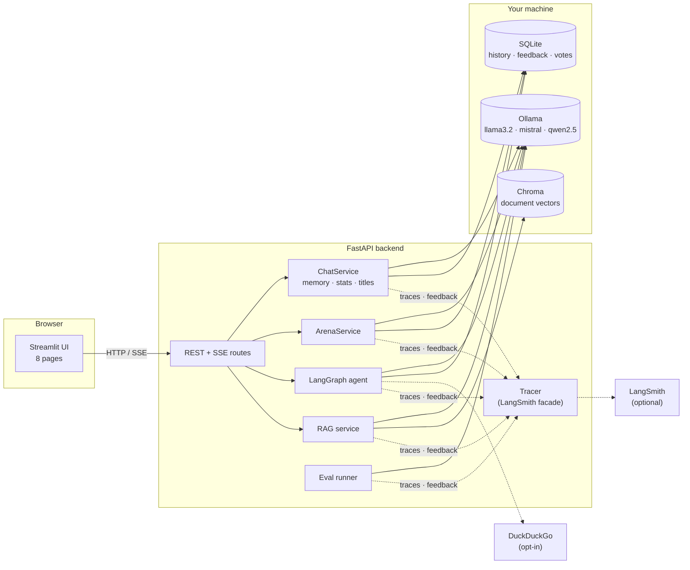

# 🧠 LocalMind: Private LLM Chat Studio with Observability

[](https://github.com/abhishek-yadav4077/localmind/actions/workflows/ci.yml)


A fully local chatbot platform on [Ollama](https://ollama.com): **no prompt or
answer leaves your machine.** Chat with open-source models, compare them in a
blind arena, let a LangGraph agent use tools, ask questions about your PDFs, and
monitor and evaluate everything with **LangSmith**: traces, user feedback,
datasets and experiments.


---

## Why this project

It started as *Assignment 24: Ollama Chatbot*: install Ollama, pull a model,
call it through LangChain's Ollama wrapper and trace it with LangSmith. That part
is [`scripts/basic_chat.py`](scripts/basic_chat.py) (~40 lines).

The rest asks what it takes to run local LLMs *properly*: choosing a model with
evidence instead of vibes, seeing what the model actually received, collecting
user feedback, and catching regressions, all without giving up privacy.

## Features

| Area | What you get |
|---|---|
| 💬 **Chat** | Streaming answers · model switcher per conversation · temperature / top-p / max tokens / context window · personas · SQLite history with search, rename, delete, Markdown/JSON export · auto titles · automatic **memory summarization** near the context limit · per-message **latency, time-to-first-token, tokens/sec, token counts** |
| ⚔️ **Model Arena** | One prompt → 2–3 models streaming side by side · **blind voting** (names and speed hidden until you vote) · sequential mode for fair speed comparison · leaderboard (win rate, tokens/sec) |
| 🛠️ **Agent** | Hand-built **LangGraph** ReAct loop · tools: safe calculator, date/time, search over past conversations, DuckDuckGo web search (**the only online feature, off by default**) · every tool call shown in the UI · loop guard |
| 📄 **Documents** | PDF/TXT/MD → chunks → `nomic-embed-text` → local Chroma · answers with `[n]` citations and page numbers · flags citations to non-existent sources |
| 🔍 **Observability** | Every run traced with `mode`, `model`, `persona`, `conversation_id`, `app_version` · 👍/👎 + comment sent to LangSmith as feedback on the exact run · trace link on every message · conversations grouped as LangSmith threads · **works without LangSmith** (tracing disabled with one warning) |
| 🧪 **Evaluation** | 30 prompts × 5 categories · LangSmith experiment per model + comparison view · LLM-as-judge correctness, conciseness, refusal / over-refusal, latency · CSV results + hardware recorded · Evaluation page |
| 📊 **Dashboard** | Answers per model, average latency and tokens/sec, feedback ratio, arena win rates, trends over time |

## Architecture



**How one chat turn flows:** the UI posts to `/chat` → `ChatService` saves your
message, builds the prompt (persona + memory summary + recent turns), summarizes
older turns if the prompt nears the context window, then streams tokens from
Ollama back over Server-Sent Events while timing them. The answer is saved with
its stats and LangSmith `run_id`, so the 👍 you click later lands on that exact trace.

## Benchmarks

<!-- BENCHMARK:START -->
_Not run yet._ Every number in this section is generated from a real evaluation
run on the author's machine, never typed by hand:

```bash
python scripts/run_eval.py --judge qwen2.5:7b      # writes eval/results/<run_id>_*.csv + meta.json
python scripts/benchmark_table.py --write          # regenerates this section (incl. hardware)
```
<!-- BENCHMARK:END -->

## Quick start (local)

**Prerequisites:** Python 3.11+, [Ollama](https://ollama.com/download), ~8 GB RAM
(16 GB recommended to run 2–3 models).

```bash
git clone https://github.com/abhishek-yadav4077/localmind.git && cd localmind
python -m venv .venv && source .venv/bin/activate     # Windows: .venv\Scripts\activate
pip install -e ".[dev]"                               # app + document chat + web search + dev tools

ollama pull llama3.2 && ollama pull qwen2.5:3b && ollama pull nomic-embed-text
cp .env.example .env                                  # optional: add your LangSmith key

python scripts/check_setup.py                         # checks Ollama + LangSmith, prints fixes
make dev                                              # API → :8000/docs, UI → :8501
```

`make dev` runs `uvicorn localmind.api.main:app` and
`streamlit run src/localmind/ui/app.py`; run them in two terminals if you don't have `make`.

**Windows (PowerShell):**

```powershell
py -3.12 -m venv .venv
.venv\Scripts\Activate.ps1          # if blocked: Set-ExecutionPolicy -Scope CurrentUser RemoteSigned
pip install -e ".[dev]"
copy .env.example .env
uvicorn localmind.api.main:app --port 8000          # terminal 1
streamlit run src/localmind/ui/app.py               # terminal 2 (activate the venv there too)
```

**8 GB RAM:** use `llama3.2` and `qwen2.5:3b` (+ `llama3.2:1b` as a third arena model) and
skip `mistral` (7B); run the arena in sequential mode.
Minimal install without document chat: `pip install -e .` (add `".[rag]"` / `".[web]"` later).

## Docker

```bash
docker compose up -d --build        # Ollama + model download + API + UI
open http://localhost:8501          # first start downloads the models (several GB)
```

| Service | What it is |
|---|---|
| `ollama` | `ollama/ollama` with a named volume, so models survive rebuilds |
| `model-init` | One-shot job pulling `LOCALMIND_MODELS` (default `llama3.2 qwen2.5:3b nomic-embed-text`) |
| `api` | FastAPI on :8000. SQLite and Chroma live in the `app_data` volume; `eval/results` is mounted from the host |
| `ui` | Streamlit on :8501, talks to `api` |

**Use the Ollama already installed on your computer** (no second copy of the models):

```bash
docker compose -f docker-compose.yml -f docker-compose.host-ollama.yml up -d --build
```

On Linux, make host Ollama listen on all interfaces first (`OLLAMA_HOST=0.0.0.0`,
e.g. via `sudo systemctl edit ollama`). Docker Desktop on macOS/Windows works as is.
**NVIDIA GPU:** uncomment the `deploy` block of the `ollama` service.

## LangSmith setup

1. Create a free account at [smith.langchain.com](https://smith.langchain.com) → *Settings → API Keys*.
2. In `.env`:
   ```bash
   LANGSMITH_TRACING=true
   LANGSMITH_API_KEY=lsv2_...
   LANGSMITH_PROJECT=localmind
   # EU accounts: LANGSMITH_ENDPOINT=https://eu.api.smith.langchain.com
   ```
3. `python scripts/check_setup.py` → `[ok] tracing to project 'localmind'`.

What gets sent: prompts, answers and timings of traced runs (that is what tracing
means). Without a key, nothing is sent and the app works the same.

## Using it

| UI page | |
|---|---|
| Chat | Conversations, personas, parameters, stats, feedback, export |
| Model Arena | Blind side-by-side comparison + leaderboard |
| Agent | Tool-using agent with a visible tool-call trail |
| Documents | Upload, index, ask with citations |
| Personas | Edit the system-prompt presets |
| Dashboard | Local analytics |
| Evaluation | Results of `run_eval.py` runs + LangSmith links |
| Settings | Ollama status, pull models with progress, LangSmith status |

| Script | |
|---|---|
| `scripts/basic_chat.py` | Assignment 24: one prompt via `OllamaLLM` and `ChatOllama`, traced |
| `scripts/check_setup.py` | Diagnose Ollama and LangSmith |
| `scripts/run_eval.py` | Run the evaluation (`--per-category 1` for a quick run, `--local` to skip LangSmith) |
| `scripts/benchmark_table.py` | Build the README benchmark tables from a run |
| `scripts/chat_cli.py`, `arena_cli.py`, `agent_cli.py`, `docs_cli.py` | Terminal versions of each feature |

## Assignment 24 checklist

| Task 1 step | Where |
|---|---|
| 1. Install and run Ollama locally | [Quick start](#quick-start-local), `scripts/check_setup.py` (health check with fix instructions) |
| 2. Pull a model (llama3, mistral) | `ollama pull ...`, or the Settings page (progress bar) |
| 3. Use LangChain's Ollama LLM wrapper | `scripts/basic_chat.py`: `OllamaLLM` and `ChatOllama` from `langchain_ollama` |
| 4. Send a prompt and print the response | `python scripts/basic_chat.py --prompt "..."` |
| 5. Track the application with LangSmith | env-based tracing + run names, tags, metadata (see [LangSmith setup](#langsmith-setup)) |
| 6. Screenshots of LangSmith | [`docs/screenshots/`](docs/screenshots/README.md) checklist |

## Screenshots

| Chat | Arena |
|---|---|
|  |  |
| **Agent** | **Evaluation** |
|  |  |
| **LangSmith trace with metadata** | **LangSmith experiment comparison** |
|  |  |

## Project structure

```
src/localmind/
  config/      settings (pydantic-settings), structured logging
  llm/         Ollama REST client (health, pull), ChatOllama factory, error mapping
  chat/        ChatService, streaming + stats, titles, export
  memory/      summary + recent-window memory
  personas/    presets + CRUD
  arena/       parallel/sequential battles, votes, leaderboard
  agent/       LangGraph graph + tools
  rag/         loaders, Chroma store, citation chain (optional extra)
  tracing/     LangSmith setup, run metadata, Tracer facade, feedback
  evaluation/  dataset, evaluators, runner, results, README report
  db/          SQLAlchemy models, repositories, analytics, migrations
  api/         FastAPI app + routes (REST + SSE)
  ui/          Streamlit app + views
scripts/       assignment script, setup check, CLIs, eval
tests/         pytest: every model call mocked, no Ollama needed
eval/          dataset.json + results/
docs/          CONCEPTS.md, screenshots/
```

## Testing & CI

```bash
make check        # ruff lint + format check + pytest
pytest --cov=localmind
```

The suite (180 tests, ~94% line coverage) runs without Ollama or LangSmith:
models are replaced by fakes that stream like `ChatOllama` (with Ollama-style
token counts and timings), Ollama's REST API by `httpx.MockTransport`, LangSmith
by a mocked client, Chroma by an in-memory collection, and the UI is smoke-tested
with Streamlit's `AppTest`. GitHub Actions runs lint, tests on Python 3.11–3.13,
and a Docker build.

## Design decisions

- **UI → API → services.** Streamlit only talks HTTP, so the backend is testable
  on its own and the UI could be replaced. Services know nothing about HTTP.
- **Server-Sent Events for streaming**, not WebSockets: one-way, plain HTTP,
  trivial to consume. Streams run their first step before sending headers, so
  bad input still returns a proper 4xx.
- **One `Tracer` facade over LangSmith.** No-ops when disabled, so no code needs
  `if tracing:` checks. The `run_id` is generated *before* each call and saved on
  the message, so feedback and trace links point at the exact run.
- **Feedback is local first.** Votes go to SQLite first, then to LangSmith on a
  best-effort basis: an outage never loses a vote, and the dashboard works offline.
- **Memory = summary + recent window**, triggered only near the limit: keeps early
  facts without an extra LLM call on every turn.
- **Explicit LangGraph graph** instead of the deprecated `create_react_agent`: every
  node is visible and extensible; a recursion limit stops tool loops.
- **Fair benchmarking.** Arena has a sequential mode and evaluation runs one request
  at a time, because parallel requests on one machine share CPU/GPU/RAM and distort
  speed numbers. Hardware is recorded with every result.
- **Versioned eval datasets** (`localmind-eval-<content hash>`): editing the
  questions creates a new dataset, so experiments are never compared on different data.
- **Private by default.** Inference, embeddings and storage are local; Chroma and
  Streamlit telemetry are disabled; web search is opt-in and labelled.

## Limitations

- **Small models are small.** 3B models get multi-step reasoning and long
  documents wrong more often; the agent sometimes picks the wrong tool.
- **LLM-as-judge** with a local judge is noisy and biased (see
  [CONCEPTS.md](docs/CONCEPTS.md#7-llm-as-judge-pros-and-cons)); 30 examples are too
  few to separate close models. Treat scores as indicative.
- **Refusal detection** is a regex on the start of the answer and misses unusual phrasings.
- **Token counts for memory** are estimated (~4 chars/token); Ollama exposes no tokenizer.
- **Speed numbers** are only comparable on the same machine.
- **Single user**: no authentication; SQLite; schema changes beyond added columns need a real migration tool.

## Future work

- Alembic migrations and Postgres for multi-user deployments
- Bradley-Terry / Elo ratings for the arena instead of raw win rate
- Human-labelled subset to calibrate the LLM judge; pairwise (A/B) judging
- Hybrid search (BM25 + vectors) and re-ranking for document chat
- Ollama's OpenAI-compatible API to compare against a hosted model in the arena
- Online evaluators in LangSmith on production traces; alerting on latency or feedback drops

## Learn more

[`docs/CONCEPTS.md`](docs/CONCEPTS.md): Ollama internals, LLM vs chat wrappers,
local vs API models, quantization, context and memory strategies, LangSmith
concepts, LLM-as-judge.

## License

MIT, see [LICENSE](LICENSE).
